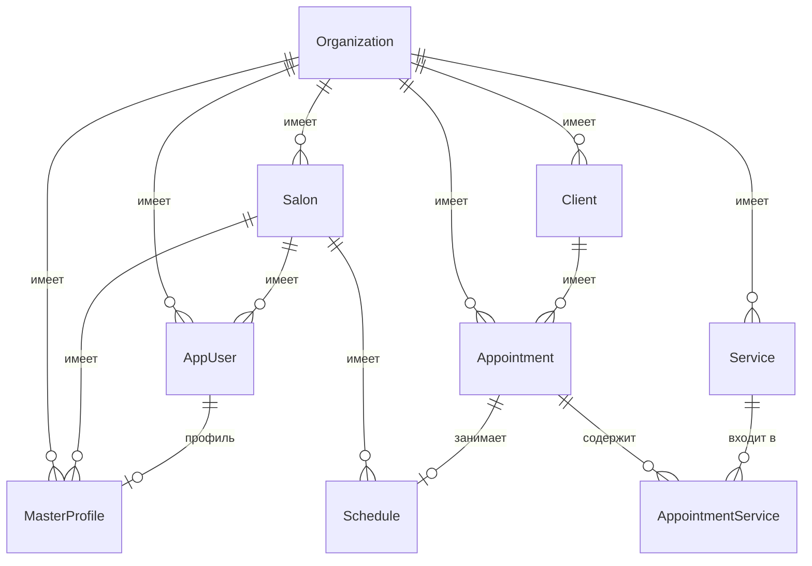

# BlankoCRM — Техническая документация для разработчиков

> Документация описывает текущее состояние кодовой базы на момент написания.
> Нереализованные части (кэширование, мониторинг, тесты) отмечены в соответствующих разделах.

---

## Содержание

1. [Общее описание проекта](#1-общее-описание-проекта)
2. [Архитектура и структура проекта](#2-архитектура-и-структура-проекта)
3. [Модель данных (сущности и связи)](#3-модель-данных-сущности-и-связи)
4. [Бизнес-логика (ключевые сценарии)](#4-бизнес-логика-ключевые-сценарии)
5. [API Endpoints (полный список)](#5-api-endpoints-полный-список)
6. [Аутентификация и авторизация](#6-аутентификация-и-авторизация)
7. [Мультитенантность (изоляция данных)](#7-мультитенантность-изоляция-данных)
8. [Обработка ошибок и валидация](#8-обработка-ошибок-и-валидация)
9. [Unit of Work и транзакции](#9-unit-of-work-и-транзакции)
10. [Кэширование, логирование, мониторинг](#10-кэширование-логирование-мониторинг)
11. [Инструкция по запуску проекта](#11-инструкция-по-запуску-проекта)
12. [Миграции базы данных](#12-миграции-базы-данных)
13. [Тестирование](#13-тестирование)
14. [Решение типичных проблем](#14-решение-типичных-проблем)

---

## 1. Общее описание проекта

### Название
**BlankoCRM**

### Краткое описание
BlankoCRM — это бэкенд-платформа (REST API) для управления записями клиентов, услугами и расписанием работы мастеров. Система предназначена для салонов красоты и самозанятых мастеров, поддерживает мультитенантность (строгая изоляция данных между организациями) и позволяет работать как отдельному мастеру, так и сети салонов.

### Целевая аудитория
- Самозанятые мастера (одиночные исполнители).
- Администраторы салонов и сетей салонов.

### Основные возможности
- Ведение базы клиентов (с поиском по имени/телефону).
- Управление услугами (длительность, цена, описание).
- Создание и управление записями (appointments) с привязкой к клиенту и нескольким услугам.
- Ведение расписания (schedule): свободные и занятые слоты времени.
- Проверка пересечений интервалов времени (защита от наложений записей).
- Мультитенантность через глобальные фильтры по `OrganizationId`.
- JWT-аутентификация на базе ASP.NET Core Identity.

### Технологический стек

| Технология | Версия | Назначение |
|---|---|---|
| .NET | 9.0 (`net9.0`) | Целевая платформа |
| ASP.NET Core | 9.x | Веб-слой, контроллеры, middleware |
| Entity Framework Core | 9.0.13 | ORM, миграции |
| Npgsql.EntityFrameworkCore.PostgreSQL | 9.0.4 | Провайдер PostgreSQL |
| PostgreSQL | 15 (Docker-образ) | СУБД |
| ASP.NET Core Identity | 9.0.13 | Управление пользователями и ролями |
| JWT (Microsoft.AspNetCore.Authentication.JwtBearer) | 9.0.13 | Аутентификация |
| System.IdentityModel.Tokens.Jwt | 8.4.0 | Генерация/разбор JWT |
| AutoMapper | 12.0.1 | Маппинг Entity → DTO |
| FluentValidation | 12.1.1 | Валидация запросов |
| FluentValidation.AspNetCore | 11.3.1 | Интеграция FluentValidation с MVC |
| Swashbuckle.AspNetCore | 10.1.7 | Swagger / OpenAPI |

---

## 2. Архитектура и структура проекта

Проект реализован по классической многослойной (Clean Architecture) схеме с разделением ответственности.

### Слои

| Проект | Назначение | Ключевое содержимое |
|---|---|---|
| `BlankoCRM.Core` | Доменные сущности, интерфейсы репозиториев/Unit of Work, доменные исключения | `Entities/`, `Interfaces/`, `Exceptions/` |
| `BlankoCRM.Infrastructure` | Реализация репозиториев, `AppDbContext`, миграции, Unit of Work, контекст организации | `Data/`, `Repositories/`, `Migrations/`, `OrganizationContext.cs` |
| `BlankoCRM.Application` | Бизнес-логика (сервисы), DTO, маппинг (AutoMapper), валидация (FluentValidation) | `Services/`, `Abstract/`, `DTOs/`, `Validation/` |
| `BlankoCRM.Web` | Контроллеры, middleware, конфигурация приложения | `Controllers/`, `Middleware/`, `Program.cs` |

### Диаграмма зависимостей (текстовое описание)

```
BlankoCRM.Web
   ├── BlankoCRM.Application
   └── BlankoCRM.Infrastructure
         └── BlankoCRM.Core

BlankoCRM.Application
   ├── BlankoCRM.Core
   └── BlankoCRM.Infrastructure
         └── BlankoCRM.Core

BlankoCRM.Infrastructure
   └── BlankoCRM.Core
```

Стрелки зависимостей (сборки):

```
Web ──────────────► Application ──────────► Infrastructure ──────────► Core
  └───────────────► Infrastructure ───────► Core
```

- `BlankoCRM.Core` не зависит ни от кого (кроме пакета `Microsoft.Extensions.Identity.Stores` для типов Identity).
- `BlankoCRM.Infrastructure` зависит только от `BlankoCRM.Core`.
- `BlankoCRM.Application` зависит от `BlankoCRM.Core` и `BlankoCRM.Infrastructure`.
- `BlankoCRM.Web` зависит от `BlankoCRM.Application` и `BlankoCRM.Infrastructure` (и транзитивно от `Core`).

### Используемые паттерны

#### Repository (Репозиторий)
- Базовый контракт: `IRepository<T>` (`BlankoCRM.Core/Interfaces/IRepository.cs`).
- Базовая реализация: `EfRepository<T>` (`BlankoCRM.Infrastructure/Repositories/EfRepository.cs`) — обёртка над `AppDbContext` (`Set<T>()`).
- Специализированные репозитории:
  - `IAppointmentRepository` / `AppointmentRepository` — запросы с `.Include(Client, AppointmentServices)`, `GetForDayAsync`, `HasOverlapAsync`.
  - `IScheduleRepository` / `ScheduleRepository` — слоты, проверка пересечений, `DeleteFreeSlotsByTimeAsync`.
  - `IServiceRepository` / `ServiceRepository` — загрузка услуги вместе с `AppointmentServices`.
- Регистрация открытого generic: `services.AddScoped(typeof(IRepository<>), typeof(EfRepository<>))` плюс явные привязки для специализированных репозиториев (`BlankoCRM.Infrastructure/DependencyInjection.cs`).

#### Unit of Work (Единица работы)
- Абстракция `IUnitOfWork` / `IUnitOfWorkTransaction` (`BlankoCRM.Core/Interfaces/IUnitOfWork.cs`).
- Реализация `EfUnitOfWork` (`BlankoCRM.Infrastructure/Data/EfUnitOfWork.cs`), оборачивает `AppDbContext`.
- Позволяет атомарно сохранять изменения и управлять транзакциями. Подробнее в разделе 9.

#### Dependency Injection (Внедрение зависимостей)
- Встроенный DI-контейнер ASP.NET Core.
- Каждый слой предоставляет метод расширения:
  - `AddInfrastructureRepositories()` — репозитории и Unit of Work.
  - `AddApplicationServices()` — сервисы, AutoMapper, FluentValidation.
- Все сервисы репозиториев и приложения регистрируются как **Scoped** (время жизни «на запрос»).

#### Global Query Filter (Глобальный фильтр запросов)
- Используется для автоматической изоляции данных по организации.
- Конфигурация в `AppDbContext.OnModelCreating`: для каждой сущности, реализующей `IOrganizationEntity`, применяется `HasQueryFilter` (подробнее в разделе 7).

---

## 3. Модель данных (сущности и связи)

### Список сущностей

| Сущность | Назначение | Реализует `IOrganizationEntity` |
|---|---|---|
| `Organization` | Организация верхнего уровня (тенант). Корень иерархии мультитенантности. | Нет |
| `Salon` | Салон, принадлежащий организации. | Да |
| `AppUser` | Пользователь системы (наследник `IdentityUser<Guid>`). | Нет |
| `AppRole` | Роль пользователя (наследник `IdentityRole<Guid>`). | Нет |
| `MasterProfile` | Профиль мастера, связанный с пользователем Identity. | Да |
| `Client` | Клиент мастера/салона. | Да |
| `Service` | Услуга (название, длительность, цена). | Да |
| `Appointment` | Запись клиента на приём (связывает клиента, услуги и время). | Да |
| `AppointmentService` | Промежуточная сущность many-to-many между `Appointment` и `Service` (с ценой/длительностью на момент записи). | Да |
| `Schedule` | Слот расписания (свободный или занятый записью). | Да |

### Поля сущностей

#### `Organization`
| Поле | Тип | Описание |
|---|---|---|
| `Id` | `Guid` | Первичный ключ |
| `Name` | `string` | Название (обязательное, макс. 100) |
| `CreatedAt` | `DateTime` | Дата создания |
| `UpdatedAt` | `DateTime?` | Дата обновления |

Навигационные коллекции: `Clients`, `Services`, `Appointments`, `Salons`, `MasterProfiles`, `Users`.

#### `Salon`
| Поле | Тип | Описание |
|---|---|---|
| `Id` | `Guid` | Первичный ключ |
| `OrganizationId` | `Guid` | Владелец |
| `Name` | `string` | Название (обязательное, макс. 150) |
| `Address` | `string?` | Адрес |
| `Phone` | `string?` | Телефон |
| `CreatedAt` | `DateTime` | Дата создания |
| `UpdatedAt` | `DateTime?` | Дата обновления |

Навигация: `Organization`, `MasterProfiles`.

#### `AppUser` (наследник `IdentityUser<Guid>`)
| Поле | Тип | Описание |
|---|---|---|
| `Id` | `Guid` | Наследуется от `IdentityUser<Guid>` |
| `OrganizationId` | `Guid` | Организация |
| `SalonId` | `Guid?` | Салон (опционально) |
| `Name` | `string` | Имя (обязательное, макс. 100) |

Плюс все стандартные поля Identity (`UserName`, `Email`, `PasswordHash`, `PhoneNumber` и т.д.).
Навигация: `Organization`, `Salon`, `MasterProfile`.

#### `AppRole`
Пустая (`IdentityRole<Guid>` без дополнительных полей).

#### `MasterProfile`
| Поле | Тип | Описание |
|---|---|---|
| `Id` | `Guid` | Первичный ключ |
| `OrganizationId` | `Guid` | Организация |
| `UserId` | `Guid` | Связанный `AppUser` (1:1) |
| `SalonId` | `Guid?` | Салон |
| `Specialization` | `string?` | Специализация |
| `HireDate` | `DateTime?` | Дата найма |
| `BirthDate` | `DateTime?` | Дата рождения |

Навигация: `Organization`, `Salon`, `User`.

#### `Client`
| Поле | Тип | Описание |
|---|---|---|
| `Id` | `Guid` | Первичный ключ |
| `OrganizationId` | `Guid` | Организация |
| `SalonId` | `Guid?` | Салон |
| `Name` | `string` | Имя (обязательное, макс. 200) |
| `Phone` | `string` | Телефон (обязательный, макс. 20) |
| `Telegram` | `string?` | Telegram (макс. 100) |
| `BirthDate` | `DateTime?` | Дата рождения |
| `Notes` | `string?` | Заметки (аллергии, предпочтения) |
| `CreatedAt` | `DateTime` | Дата создания |
| `UpdatedAt` | `DateTime?` | Дата обновления |

Навигация: `Organization`, `Salon`, `Appointments`.

#### `Service`
| Поле | Тип | Описание |
|---|---|---|
| `Id` | `Guid` | Первичный ключ |
| `OrganizationId` | `Guid` | Организация |
| `SalonId` | `Guid?` | Салон |
| `Name` | `string` | Название (обязательное, макс. 100) |
| `DurationMinutes` | `int` | Длительность в минутах |
| `Price` | `decimal` | Стоимость (`decimal(18,2)`) |
| `Description` | `string?` | Описание |
| `CreatedAt` | `DateTime` | Дата создания |
| `UpdatedAt` | `DateTime?` | Дата обновления |

Навигация: `Organization`, `Salon`, `AppointmentServices`.

#### `Appointment`
| Поле | Тип | Описание |
|---|---|---|
| `Id` | `Guid` | Первичный ключ |
| `OrganizationId` | `Guid` | Организация |
| `SalonId` | `Guid?` | Салон |
| `ClientId` | `Guid` | Клиент |
| `StartTime` | `DateTime` | Начало записи |
| `EndTime` | `DateTime` | Конец записи |
| `Status` | `AppointmentStatus` | Статус (enum, хранится как int) |
| `Notes` | `string?` | Заметки (макс. 500) |
| `ReminderSent` | `bool` | Флаг отправки напоминания (Telegram) |
| `CreatedAt` | `DateTime` | Дата создания |
| `UpdatedAt` | `DateTime?` | Дата обновления |

Вычисляемые свойства (в памяти, только после `.Include(AppointmentServices)`):

- `TotalPrice` — сумма `Price` по всем `AppointmentServices`.
- `TotalDuration` — сумма `DurationMinutes` по всем `AppointmentServices`.

> **Важно.** `TotalPrice`/`TotalDuration` вычисляются в памяти. Если `AppointmentServices` не загружены через `.Include()`, значения будут `0`. Поэтому в DTO их заполняют явно через AutoMapper после загрузки связанных данных.

Навигация: `Organization`, `Salon`, `Client`, `AppointmentServices`, `Schedule`.

##### `AppointmentStatus` (enum)
| Значение | Число | Описание |
|---|---|---|
| `Scheduled` | 0 | Запланировано |
| `Completed` | 1 | Выполнено |
| `Cancelled` | 2 | Отменено мастером или клиентом |
| `NoShow` | 3 | Клиент не пришёл |
| `Archived` | 4 | Заархивировано без физического удаления |

#### `AppointmentService`
| Поле | Тип | Описание |
|---|---|---|
| `Id` | `Guid` | Первичный ключ |
| `OrganizationId` | `Guid` | Организация |
| `SalonId` | `Guid?` | Салон |
| `AppointmentId` | `Guid` | Запись |
| `ServiceId` | `Guid` | Услуга |
| `Price` | `decimal` | Цена на момент записи (`decimal(18,2)`) |
| `DurationMinutes` | `int` | Длительность на момент записи |
| `ServiceName` | `string?` | Денормализованное название услуги (макс. 100) |
| `Quantity` | `int` | Количество (по умолчанию 1) |

Навигация: `Organization`, `Salon`, `Appointment`, `Service`.

#### `Schedule`
| Поле | Тип | Описание |
|---|---|---|
| `Id` | `Guid` | Первичный ключ |
| `OrganizationId` | `Guid` | Организация |
| `SalonId` | `Guid?` | Салон |
| `AppointmentId` | `Guid?` | Связанная запись (`null` → свободный слот) |
| `StartTime` | `DateTime` | Начало слота |
| `EndTime` | `DateTime` | Конец слота |
| `CreatedAt` | `DateTime` | Дата создания |
| `UpdatedAt` | `DateTime?` | Дата обновления |

Навигация: `Organization`, `Salon`, `Appointment`.

### Связи между сущностями

| Связь | Тип | Описание | `OnDelete` |
|---|---|---|---|
| `Organization` → `Client` | 1:many | У организации много клиентов | Cascade |
| `Organization` → `Service` | 1:many | У организации много услуг | Cascade |
| `Organization` → `Appointment` | 1:many | У организации много записей | Cascade |
| `Organization` → `Salon` | 1:many | У организации много салонов | Cascade |
| `Organization` → `MasterProfile` | 1:many | У организации много профилей мастеров | Restrict |
| `Organization` → `AppUser` | 1:many | У организации много пользователей | Restrict |
| `Client` → `Appointment` | 1:many | У клиента много записей | Restrict |
| `Appointment` → `AppointmentService` | 1:many | Запись содержит позиции услуг | Cascade |
| `Service` → `AppointmentService` | 1:many | Услуга используется в позициях | Restrict |
| `Appointment` ↔ `Schedule` | 1:1 | Занятый слот ссылается на запись (`Schedule.AppointmentId` уникальный) | Cascade |
| `AppUser` ↔ `MasterProfile` | 1:1 | Профиль привязан к пользователю (`MasterProfile.UserId`) | Cascade |
| `Salon` → `Schedule` | 1:many | Салон имеет слоты (`Schedule.SalonId`) | SetNull |
| `Salon` → `MasterProfile` | 1:many | У салона много мастеров | SetNull |
| `Salon` → `AppUser` | 1:many | У салона много пользователей | SetNull |

Дополнительно у `Client`, `Service`, `Appointment` есть nullable FK `SalonId` (опциональная привязка к салону) без отдельной обратной навигационной коллекции в `Salon`.

### ER-диаграмма (Mermaid)



> Для генерации наглядной диаграммы из кода можно использовать `dotnet ef dbcontext scaffold`/специализированные инструменты (например, `dotnet-ef` не имеет встроенной ER-команды; Diagram-диаграмму можно получить через **EF Core Power Tools** (Visual Studio) или `erdot`/`pgadmin` для готовой БД). Приведённая выше Mermaid-диаграмма отражает фактические FK-связи из `AppDbContext`.

### Индексы в БД

| Таблица | Индекс | Тип | Назначение |
|---|---|---|---|
| `Clients` | `OrganizationId` | обычный | Фильтрация по тенанту |
| `Clients` | `Phone` | обычный | Поиск по телефону |
| `Clients` | `Telegram` | обычный | Поиск по Telegram |
| `Clients` | `(OrganizationId, Phone)` | уникальный | Уникальность телефона в пределах организации |
| `Services` | `OrganizationId` | обычный | Фильтрация по тенанту |
| `Services` | `(OrganizationId, Name)` | уникальный | Уникальность названия услуги в пределах организации |
| `Appointments` | `OrganizationId` | обычный | Фильтрация по тенанту |
| `Appointments` | `StartTime` | обычный | Календарные запросы |
| `Appointments` | `(OrganizationId, StartTime)` | составной | Быстрый выбор записей календаря по организации |
| `AppointmentServices` | `OrganizationId` | обычный | Обязателен для мультитенантности |
| `AppointmentServices` | `AppointmentId` | обычный | Запрос позиций записи |
| `AppointmentServices` | `ServiceId` | обычный | Запрос позиций по услуге |
| `Schedules` | `OrganizationId` | обычный | Фильтрация по тенанту |
| `Schedules` | `(OrganizationId, SalonId, StartTime)` | составной | Выборка слотов по организации/салону/времени |
| `Schedules` | `AppointmentId` | уникальный | Гарантирует связь 1:1 слота и записи |

### Check-констрейнты (ограничения БД)

| Констрейнт | Таблица | Условие |
|---|---|---|
| `CK_Appointment_EndTime` | `Appointments` | `EndTime >= StartTime` |
| `CK_Schedule_EndTime` | `Schedules` | `EndTime > StartTime` |

---

## 4. Бизнес-логика (ключевые сценарии)

Реализация бизнес-логики находится в `BlankoCRM.Application/Services/`:
- `AppointmentService.cs` — записи.
- `ScheduleService.cs` — слоты расписания.
- `ClientService.cs`, `ServicesService.cs` — клиенты и услуги.
- `AuthService.cs` — регистрация и вход.

### 4.1 Создание записи (appointment) → автоматическое создание занятого слота

Метод: `AppointmentService.CreateWithScheduleAsync` (вызывается из `CreateAsync` и `ScheduleService.AddOccupiedSlotAsync`).

Алгоритм:
1. Проверяет, что клиент существует (`IRepository<Client>.GetByIdAsync`), иначе `NotFoundException`.
2. Если передан `SalonId` — проверяет существование салона, иначе `NotFoundException`.
3. Одним запросом загружает все услуги из списка `serviceInputs`.
4. Проверяет, что все услуги найдены, иначе `NotFoundException`.
5. Для каждой позиции строит `AppointmentService`, копируя цену/длительность/название из `Service` (если в `ServiceInput` не заданы переопределения `DurationMinutes`/`Price`), `Quantity` по умолчанию 1.
6. Считает общую длительность: `sum(DurationMinutes * Quantity)` и `EndTime = StartTime + totalDuration`.
7. Проверяет пересечение с уже занятыми слотами: `IScheduleRepository.HasOverlapWithOccupiedSlotsAsync` → при конфликте `ConflictException`.
8. Создаёт `Appointment` (статус `Scheduled`) и `Schedule` (занятый слот с тем же интервалом времени).
9. В транзакции:
   - добавляет `Appointment` и `Schedule` через Unit of Work;
   - удаляет пересекающиеся свободные слоты (`DeleteFreeSlotsByTimeAsync`);
   - сохраняет изменения и коммитит.

Итог: создаётся запись и «занятый» слот с одинаковым временем, а пересекающиеся свободные слоты удаляются.

### 4.2 Создание свободного слота

Метод: `ScheduleService.AddFreeSlotAsync`.

Алгоритм:
1. Определяет текущую организацию через `IOrganizationContext`.
2. Проверяет пересечение с любыми слотами (`HasOverlapAsync`) → при конфликте `ConflictException`.
3. Создаёт `Schedule` без `AppointmentId` (свободный слот) и сохраняет (`AddAsync`).

Массовое создание: `AddSlotsAsync` (цикл по `AddFreeSlotAsync`), эндпоинт `POST /api/schedule/free/bulk`.

### 4.3 Создание занятого слота

Метод: `ScheduleService.AddOccupiedSlotAsync` — делегирует в `AppointmentService.CreateWithScheduleAsync`, т.е. создаёт и запись, и занятый слот одновременно. Возвращает созданный `Schedule`.

### 4.4 Обновление слота → синхронизация времени записи

Метод: `ScheduleService.UpdateSlotAsync`.

Алгоритм:
1. Загружает слот с записью (`GetByIdWithAppointmentAsync`), иначе `NotFoundException`.
2. Вычисляет новые `startTime`/`endTime`.
3. Если меняется время:
   - **Свободный слот** — проверяет `HasOverlapAsync` (исключая сам слот) → `ConflictException`.
   - **Занятый слот** — проверяет `HasOverlapWithOccupiedSlotsAsync` (исключая сам слот и собственную запись) → `ConflictException`.
4. Если в запросе передан `AppointmentData`, но слот свободный → `ValidationException` («Нельзя обновить запись у свободного слота»).
5. В транзакции:
   - обновляет время слота;
   - если слот занят, синхронизирует время `Appointment` (`StartTime`/`EndTime`);
   - удаляет пересекающиеся свободные слоты;
   - если задан `AppointmentData`, делегирует обновление записи в `AppointmentService.UpdateAsync`.
6. Сохраняет и коммитит.

### 4.5 Удаление записи → архив (статус `Archived`), освобождение слота

Метод: `AppointmentService.DeleteAsync`.

Алгоритм:
1. Загружает запись с деталями, иначе `NotFoundException`.
2. Находит связанный слот по `AppointmentId`.
3. В транзакции:
   - если слот есть — отвязывает его (`AppointmentId = null`, `Appointment = null`), т.е. слот становится свободным;
   - устанавливает `appointment.Status = Archived` (запись не удаляется физически);
   - сохраняет и коммитит.

Итог: запись архивируется, а её слот освобождается (остаётся как свободный).

### 4.6 Удаление занятого слота → удаление слота, запись в Архив

Метод: `ScheduleService.RemoveSlotAsync`.

Алгоритм:
1. Загружает слот с записью, иначе `NotFoundException`.
2. В транзакции:
   - если у слота есть `Appointment` — устанавливает `Appointment.Status = Archived`, `UpdatedAt = now`;
   - отвязывает запись (`AppointmentId = null`, `Appointment = null`);
   - удаляет сам слот (`UnitOfWork.Remove`).
3. Сохраняет и коммитит.

Итог: слот физически удаляется, связанная запись переводится в архив.

Массовое удаление: `RemoveSlotsAsync` (аналогично для списка).

### 4.7 Удаление свободного слота → просто удаление

Тот же метод `ScheduleService.RemoveSlotAsync`: если у слота нет `Appointment`, запись не затрагивается — слот просто удаляется.

### 4.8 Отмена записи → статус `Cancelled`, освобождение слота

Методы:
- `AppointmentService.CancelAsync` — вызывает `UpdateStatusAsync(id, Cancelled)`.
- `AppointmentService.UpdateStatusAsync`:
  1. Загружает запись, иначе `NotFoundException`.
  2. Находит связанный слот.
  3. В транзакции:
     - устанавливает новый статус;
     - если статус `Cancelled` и слот есть — отвязывает его (`AppointmentId = null`, `Appointment = null`), делая слот свободным.
  4. Сохраняет и коммитит.

### 4.9 Проверки пересечений интервалов

Все проверки используют стандартную формулу пересечения полуоткрытых интервалов:

```
startTime < endTime && endTime > startTime
```

Реализации:
- `AppointmentRepository.HasOverlapAsync` — проверяет записи (`Appointments`):
  - фильтр по `OrganizationId`;
  - если `salonId` задан → доп. фильтр `appointment.SalonId == salonId`;
  - исключение заданной записи (`excludedAppointmentId`).
- `ScheduleRepository.HasOverlapAsync` — проверяет любые слоты (`Schedules`):
  - фильтр по `OrganizationId` и `schedule.SalonId == salonId`;
  - исключение заданного слота (`excludedSlotId`).
- `ScheduleRepository.HasOverlapWithOccupiedSlotsAsync` — проверяет только занятые слоты (`AppointmentId.HasValue`):
  - исключение слота и/или записи.
- `ScheduleRepository.DeleteFreeSlotsByTimeAsync` — находит и помечает на удаление свободные слоты (`AppointmentId == null`), пересекающиеся с интервалом.

### 4.10 Мультитенантность: глобальные фильтры по `OrganizationId`

Ключевой механизм изоляции данных (подробно — раздел 7). Все сущности `IOrganizationEntity` автоматически фильтруются по `OrganizationId`, установленному из JWT в middleware.

---

## 5. API Endpoints (полный список)

Базовый префикс всех маршрутов: `/api`.
Все эндпоинты, кроме `/api/auth/*`, защищены атрибутом `[Authorize]` (требуют JWT-токен).

### Сводная таблица

| Метод | URL | Описание | Тело запроса | Ответ |
|---|---|---|---|---|
| POST | `/api/auth/register` | Регистрация нового мастера | `RegisterUserRequest` | `201` (без тела) |
| POST | `/api/auth/login` | Вход и получение JWT | `LoginUserRequest` | `200 AuthResponse` |
| GET | `/api/clients/all` | Получить всех клиентов (с поиском) | — (query `search`) | `200 ClientDto[]` |
| GET | `/api/clients/{id}` | Получить клиента по ID | — | `200 ClientDto` |
| POST | `/api/clients/create` | Создать клиента | `CreateClientRequest` | `201 ClientDto` |
| PUT | `/api/clients/update/{id}` | Обновить клиента | `UpdateClientRequest` | `204` |
| DELETE | `/api/clients/delete/{id}` | Удалить клиента | — | `204` |
| GET | `/api/services` | Получить все услуги | — | `200 ServiceDto[]` |
| GET | `/api/services/{id}` | Получить услугу по ID | — | `200 ServiceDto` |
| POST | `/api/services` | Создать услугу | `CreateServiceRequest` | `201 ServiceDto` |
| PUT | `/api/services/{id}` | Обновить услугу | `UpdateServiceRequest` | `204` |
| DELETE | `/api/services/{id}` | Удалить услугу | — | `204` |
| GET | `/api/appointments/{id}` | Получить запись по ID | — | `200 AppointmentDto` |
| GET | `/api/appointments/all` | Получить все записи | — | `200 AppointmentDto[]` |
| GET | `/api/appointments/calendar` | Записи на дату | — (query `date`) | `200 AppointmentDto[]` |
| POST | `/api/appointments` | Создать запись | `CreateAppointmentRequest` | `201 AppointmentDto` |
| PUT | `/api/appointments/{id}` | Обновить запись | `UpdateAppointmentRequest` | `204` |
| DELETE | `/api/appointments/{id}` | Архив записи | — | `204` |
| PATCH | `/api/appointments/{id}/cancel` | Отменить запись | — | `204` |
| PATCH | `/api/appointments/{id}/status` | Изменить статус | `UpdateAppointmentStatusRequest` | `204` |
| GET | `/api/schedule/{id}` | Получить слот по ID | — | `200 ScheduleDto` |
| GET | `/api/schedule/get/period` | Слоты за период | — (query `dtFrom`, `dtTo`) | `200 ScheduleDto[]` |
| POST | `/api/schedule/free` | Создать свободный слот | `CreateFreeSlotRequest` | `201 ScheduleDto` |
| POST | `/api/schedule/occupied` | Создать занятый слот (+ запись) | `CreateOccupiedSlotRequest` | `201 ScheduleDto` |
| POST | `/api/schedule/free/bulk` | Создать несколько свободных слотов | `List<CreateFreeSlotRequest>` | `200 ScheduleDto[]` |
| DELETE | `/api/schedule/{id}` | Удалить слот | — | `200 bool` |
| DELETE | `/api/schedule/delete/bulk` | Удалить несколько слотов | `List<Guid>` | `200 int` |
| PUT | `/api/schedule/{id}` | Обновить слот | `UpdateSlotRequest` | `204` |

### DTO (структуры запросов/ответов)

#### Аутентификация

```jsonc
// RegisterUserRequest
{
  "name": "Анна",                // string?, макс 100
  "email": "anna@example.com",   // string, обязательный, валидный email
  "password": "secret123",       // string, обязательный, 6..100
  "organizationName": "Мой салон" // string?, макс 100 (если пусто — берётся Name или Email)
}

// LoginUserRequest
{
  "email": "anna@example.com",   // string, обязательный
  "password": "secret123"        // string, обязательный
}

// AuthResponse
{
  "token": "eyJhbGciOi...",      // JWT
  "name": "Анна",
  "email": "anna@example.com"
}
```

#### Клиенты

```jsonc
// ClientDto
{
  "id": "GUID",
  "name": "Мария",
  "phone": "+79001234567",
  "telegram": "@maria",
  "birthDate": "1990-05-15T00:00:00",
  "notes": "Аллергия на...",
  "salonId": "GUID | null"
}

// CreateClientRequest
{ "name": "...", "phone": "...", "telegram": "...", "birthDate": "...", "notes": "...", "salonId": null }

// UpdateClientRequest — все поля необязательные
{ "name": "...", "phone": "...", "telegram": "...", "birthDate": "...", "notes": "...", "salonId": null }
```

#### Услуги

```jsonc
// ServiceDto
{ "id": "GUID", "name": "Маникюр", "durationMinutes": 60, "price": 1500.00, "description": "...", "salonId": null }

// CreateServiceRequest
{ "name": "...", "durationMinutes": 60, "price": 1500.00, "description": "...", "salonId": null }

// UpdateServiceRequest — все поля необязательные
{ "name": "...", "durationMinutes": 60, "price": 1500.00, "description": "...", "salonId": null }
```

#### Записи

```jsonc
// CreateAppointmentRequest
{
  "clientId": "GUID",
  "services": [
    { "serviceId": "GUID", "durationMinutes": 60, "price": 1500.00, "quantity": 2 }
  ],
  "startTime": "2026-09-11T14:00:00",
  "notes": "...",
  "salonId": null
}

// ServiceInput
{ "serviceId": "GUID", "durationMinutes": null, "price": null, "quantity": 1 }

// UpdateAppointmentRequest — все поля необязательные
{ "clientId": null, "services": null, "startTime": null, "endTime": null, "status": null, "notes": null, "salonId": null }

// UpdateAppointmentStatusRequest
{ "status": 2 }   // AppointmentStatus enum

// AppointmentDto
{
  "id": "GUID",
  "clientId": "GUID",
  "clientName": "Мария",
  "services": [
    { "serviceId": "GUID", "serviceName": "Маникюр", "price": 1500.00, "durationMinutes": 60, "quantity": 2 }
  ],
  "startTime": "2026-09-11T14:00:00",
  "endTime": "2026-09-11T16:00:00",
  "status": 0,
  "notes": "...",
  "totalPrice": 3000.00,
  "totalDurationMinutes": 120
}
```

#### Расписание

```jsonc
// ScheduleDto
{
  "id": "GUID",
  "startTime": "2026-09-11T14:00:00",
  "endTime": "2026-09-11T16:00:00",
  "appointment": { /* AppointmentDto | null */ }
}

// CreateFreeSlotRequest
{ "startTime": "...", "endTime": "...", "salonId": null }

// CreateOccupiedSlotRequest
{
  "startTime": "...",
  "endTime": "...",
  "appointmentData": { /* CreateAppointmentRequest */ }
}

// CreateManySlotsRequest / bulk
[ { "startTime": "...", "endTime": "...", "salonId": null }, ... ]

// UpdateSlotRequest
{
  "startTime": "...",   // optional
  "endTime": "...",     // optional
  "appointmentData": {  // optional
    "clientId": "...", "services": [...], "status": 0, "notes": "...", "salonId": null
  }
}
```

### Таблица эндпоинтов «по контроллерам»

#### `AuthController` — `[Route("api/auth")]`, без `[Authorize]`

| Метод | Маршрут | Действие | Статус успеха |
|---|---|---|---|
| POST | `/api/auth/register` | `Register` | 201 |
| POST | `/api/auth/login` | `Login` | 200 (`AuthResponse`) |

#### `ClientsController` — `[Route("api/clients")]`, `[Authorize]`

| Метод | Маршрут | Действие | Статус успеха |
|---|---|---|---|
| GET | `/api/clients/all` | `GetAll(search?)` | 200 |
| GET | `/api/clients/{id:guid}` | `GetById` | 200 |
| POST | `/api/clients/create` | `Create` | 201 |
| PUT | `/api/clients/update/{id:guid}` | `Update` | 204 |
| DELETE | `/api/clients/delete/{id:guid}` | `Delete` | 204 |

#### `ServicesController` — `[Route("api/services")]`, `[Authorize]`

| Метод | Маршрут | Действие | Статус успеха |
|---|---|---|---|
| GET | `/api/services` | `GetAll` | 200 |
| GET | `/api/services/{id:guid}` | `GetById` | 200 |
| POST | `/api/services` | `Create` | 201 |
| PUT | `/api/services/{id:guid}` | `Update` | 204 |
| DELETE | `/api/services/{id:guid}` | `Delete` | 204 |

#### `AppointmentsController` — `[Route("api/appointments")]`, `[Authorize]`

| Метод | Маршрут | Действие | Статус успеха |
|---|---|---|---|
| GET | `/api/appointments/{id:guid}` | `GetById` | 200 |
| GET | `/api/appointments/all` | `GetAllAsync` | 200 |
| GET | `/api/appointments/calendar` | `GetForDay(date)` | 200 |
| POST | `/api/appointments` | `Create` | 201 |
| PUT | `/api/appointments/{id:guid}` | `Update` | 204 |
| DELETE | `/api/appointments/{id:guid}` | `Delete` (архив) | 204 |
| PATCH | `/api/appointments/{id:guid}/cancel` | `Cancel` | 204 |
| PATCH | `/api/appointments/{id:guid}/status` | `UpdateStatus` | 204 |

#### `ScheduleController` — `[Route("api/schedule")]`, `[Authorize]`

| Метод | Маршрут | Действие | Статус успеха |
|---|---|---|---|
| GET | `/api/schedule/{id:guid}` | `GetSlotByIdAsync` | 200 |
| GET | `/api/schedule/get/period` | `GetScheduleByPeriod(dtFrom, dtTo)` | 200 |
| POST | `/api/schedule/free` | `AddFreeSlotAsync` | 201 |
| POST | `/api/schedule/occupied` | `AddOccupiedSlotAsync` | 201 |
| POST | `/api/schedule/free/bulk` | `AddSlotsAsync` | 200 |
| DELETE | `/api/schedule/{id:guid}` | `DeleteSlotAsync` | 200 (`bool`) |
| DELETE | `/api/schedule/delete/bulk` | `DeleteScheduleAsync` | 200 (`int`) |
| PUT | `/api/schedule/{id:guid}` | `UpdateSlotAsync` | 204 |

> Полный интерактивный список доступен в Swagger UI (см. раздел 11).

---

## 6. Аутентификация и авторизация

### Как работает JWT-аутентификация

1. Пользователь вызывает `POST /api/auth/register` — создаётся `Organization` и `AppUser` (ASP.NET Core Identity).
2. Пользователь вызывает `POST /api/auth/login` — выполняются `FindByEmailAsync` и `CheckPasswordSignInAsync`.
3. При успехе генерируется JWT (`AuthService.GenerateJwtToken`).
4. Клиент передаёт токен в заголовке `Authorization: Bearer {token}`.
5. `AddJwtBearer` (в `Program.cs`) валидирует подпись, issuer и audience.
6. Middleware извлекает claim `organizationId` и устанавливает `OrganizationContext` для глобальных фильтров.
7. `[Authorize]` защищает контроллеры.

### Настройка JWT (Program.cs)

```
ValidateIssuer = true
ValidateAudience = true
ValidateIssuerSigningKey = true
ValidIssuer = Jwt:Issuer        // по умолчанию "BlankoCRM"
ValidAudience = Jwt:Audience    // по умолчанию "BlankoCRMClient"
IssuerSigningKey = SymmetricSecurityKey(UTF8.GetBytes(Jwt:Key))
ClockSkew = TimeSpan.Zero
```

### Формат токена: claims

| Claim | Значение | Источник |
|---|---|---|
| `sub` | `user.Id` | `JwtRegisteredClaimNames.Sub` |
| `nameidentifier` | `user.Id` | `ClaimTypes.NameIdentifier` |
| `name` | `user.Name` | `ClaimTypes.Name` |
| `email` | `user.Email` | `JwtRegisteredClaimNames.Email` |
| `organizationId` | `user.OrganizationId` | кастомный claim |
| `salonId` | `user.SalonId` | добавляется только если задан |
| `jti` | `Guid` | уникальный идентификатор токена |
| `role` (могут быть несколько) | роли пользователя | `ClaimTypes.Role` |

Срок действия: **7 дней** (`expires: DateTime.UtcNow.AddDays(7)`).
Алгоритм подписи: `HmacSha256`.

### Как добавить JWT в Swagger

Уже реализовано в `Program.cs`:
- `AddSecurityDefinition("Bearer", ...)` — определяет схему `Http`/`bearer`.
- `AddSecurityRequirement(...)` — применяет требование Bearer ко всем эндпоинтам.
- В Swagger UI появится кнопка **Authorize**, куда вставляется `Bearer {token}`.

### Использование `[Authorize]`

- `AuthController` — **без** `[Authorize]` (публичный).
- `ClientsController`, `ServicesController`, `AppointmentsController`, `ScheduleController` — `[Authorize]` на уровне контроллера.
- Ролевая авторизация (`[Authorize(Roles = "...")]`) в текущем коде **не используется** — только сам факт аутентификации.

### Конфигурация Identity

`Program.cs` регистрирует:
```
AddIdentityCore<AppUser>()
  .AddRoles<AppRole>()
  .AddEntityFrameworkStores<AppDbContext>()
  .AddSignInManager()
  .AddDefaultTokenProviders();
```

`AppDbContext` наследует `IdentityDbContext<AppUser, AppRole, Guid>`.

---

## 7. Мультитенантность (изоляция данных)

### Ключевые компоненты

| Компонент | Файл | Роль |
|---|---|---|
| `IOrganizationEntity` | `Core/Interfaces/IOrganizationEntity.cs` | Маркер: сущность имеет `OrganizationId` |
| `IOrganizationContext` | `Core/Interfaces/IOrganizationContext.cs` | Абстракция текущей организации |
| `OrganizationContext` | `Infrastructure/OrganizationContext.cs` | Реализация на `AsyncLocal<Guid?>` |
| Глобальные фильтры | `Infrastructure/Data/AppDbContext.cs` | Автофильтрация в EF Core |
| Middleware установки контекста | `Web/Program.cs` | Извлекает `organizationId` из JWT |

### Как работает глобальный фильтр

В `AppDbContext.OnModelCreating` для каждой сущности, реализующей `IOrganizationEntity`, через дерево выражений строится фильтр:

```csharp
// e.OrganizationId == OrganizationContext.CurrentOrganizationId.Value
// при условии, что OrganizationContext.CurrentOrganizationId.HasValue
e => OrganizationContext.CurrentOrganizationId.HasValue
     && e.OrganizationId == OrganizationContext.CurrentOrganizationId.Value
```

Важная деталь: фильтр обращается к **статическому** свойству `OrganizationContext.CurrentOrganizationId` (без захвата экземпляра), поэтому корректен при создании нескольких `DbContext`/запросов.

- Если `CurrentOrganizationId == null` (анонимный запрос) → фильтр не ограничивает данные (условие `HasValue` ложно).
- Если `CurrentOrganizationId` установлен → все `IOrganizationEntity` автоматически фильтруются по нему.

За счёт этого сервисы (`ClientService`, `ServicesService`, `AppointmentService`, `ScheduleService`) не добавляют ручные фильтры по организации: изоляция происходит на уровне EF Core.

### Как устанавливается `OrganizationId` в middleware

`Program.cs` добавляет inline-middleware после `UseAuthentication`/`UseAuthorization`:

1. В начале каждого запроса `organizationContext.Clear()`.
2. Если пользователь аутентифицирован (`context.User.Identity.IsAuthenticated`):
   - читает claim `organizationId`;
   - при успешном `Guid.TryParse` — `SetCurrentOrganizationId(organizationId)`.
3. Вызывает `next()`.
4. В `finally` — снова `Clear()` (чтобы контекст не «протекал» между запросами).

Это критически важно для корректности глобальных фильтров: анонимные запросы (регистрация/логин) не должны фильтроваться.

### Проверка принадлежности салона (`EnsureSalonBelongsToOrganizationAsync`)

Салон является `IOrganizationEntity`, поэтому `_salonRepository.GetByIdAsync(salonId)` уже автоматически фильтруется по текущей организации. Если салон принадлежит другой организации — запрос вернёт `null` и сервис выбросит `NotFoundException`.

Метод реализован в:
- `ClientService.EnsureSalonBelongsToOrganizationAsync`
- `ServicesService.EnsureSalonBelongsToOrganizationAsync`
- В `AppointmentService` аналогичная проверка выполнялась inline (`if (salonId.HasValue && await _salonRepository.GetByIdAsync(...) is null)`).

### Как отключить глобальный фильтр (для администратора/сервисных задач)

Для конкретного запроса можно использовать `IgnoreQueryFilters()`:

```csharp
var allClients = await dbContext.Clients.IgnoreQueryFilters().ToListAsync();
```

В текущем проекте репозитории не предоставляют такой обход «из коробки» — для этого потребуется добавить метод в репозиторий с `IgnoreQueryFilters()`.

---

## 8. Обработка ошибок и валидация

### Иерархия исключений

| Исключение | HTTP | Наследование | Когда бросается |
|---|---|---|---|
| `DomainException` | (абстрактный) | `Exception` | Базовый тип предметной области |
| `NotFoundException` | 404 | `DomainException` | Сущность не найдена |
| `ConflictException` | 409 | `DomainException` | Конфликт бизнес-правил (пересечение слотов, удаление используемой услуги) |
| `ValidationException` | 400 | `DomainException` | Ошибка бизнес-валидации (например, обновление записи у свободного слота, ошибки Identity) |
| `UnauthorizedException` | 401 | `DomainException` | Неверный email/пароль при входе |

Файлы: `BlankoCRM.Core/Exceptions/`.

### Глобальный middleware (`ExceptionHandlingMiddleware`)

Файл: `BlankoCRM.Web/Middleware/ExceptionHandlingMiddleware.cs`.
Регистрируется в `Program.cs` перед `UseAuthentication` (чтобы перехватывать исключения последующих middleware/контроллеров).

Обработчики:
1. `DomainException` → статус из `ex.StatusCode`, JSON `{ "error": message }`.
2. `UnauthorizedAccessException` → 401.
3. `DbUpdateException` → маппинг кодов PostgreSQL:
   - `UniqueViolation` → 409 («A record with the same unique value already exists.»);
   - `ForeignKeyViolation` → 400;
   - `CheckViolation` → 400;
   - иначе → 500.
4. `Exception` (всё остальное) → 500, обёрнутое сообщение.

Формат ответа об ошибке всегда JSON: `{ "error": "..." }`.

### FluentValidation

- Пакеты: `FluentValidation` 12.1.1, `FluentValidation.DependencyInjectionExtensions` 12.1.1, `FluentValidation.AspNetCore` 11.3.1.
- Регистрация:
  - в `Application/DependencyInjection.cs`: `services.AddValidatorsFromAssembly(Assembly.GetExecutingAssembly())`;
  - в `Program.cs`: `builder.Services.AddFluentValidationAutoValidation()`.
- Все валидаторы находятся в `BlankoCRM.Application/Validation/RequestValidators.cs`.

### Список валидаторов

| Валидатор | Правила |
|---|---|
| `RegisterUserRequestValidator` | `Email` непустой/email/≤100; `Password` 6..100; `Name` ≤100; `OrganizationName` ≤100 |
| `LoginUserRequestValidator` | `Email` непустой/email; `Password` непустой |
| `CreateClientRequestValidator` | `Name` ≤200; `Phone` ≤20; `Telegram` ≤100; `Notes` ≤500 |
| `UpdateClientRequestValidator` | `Name` ≤200; `Phone` ≤20; `Telegram` ≤100; `Notes` ≤500 |
| `CreateServiceRequestValidator` | `Name` ≤100; `DurationMinutes` 1..1440; `Price` 0..999999.99; `Description` ≤500 |
| `UpdateServiceRequestValidator` | те же лимиты, но только если значение задано (`When(...HasValue)`) |
| `ServiceInputValidator` | `ServiceId` непустой; `DurationMinutes` 1..1440 (если задано); `Price` ≥0 (если задана); `Quantity` >0 |
| `CreateAppointmentRequestValidator` | `ClientId` непустой; `Services` непустой (через `ServiceInputCollectionValidator`) |
| `ServiceInputCollectionValidator` | каждый элемент списка услуг через `ServiceInputValidator` |
| `UpdateAppointmentRequestValidator` | `Notes` ≤500 |
| `CreateFreeSlotRequestValidator` | `StartTime` непустой; `EndTime` > `StartTime` |
| `UpdateSlotRequestValidator` | `EndTime` > `StartTime` (если оба заданы) |
| `CreateManySlotsRequestValidator` | `Slots` непустой; каждый слот через `CreateFreeSlotRequestValidator` |
| `CreateFreeSlotRequestListValidator` | список слотов непустой; каждый через `CreateFreeSlotRequestValidator` |

> Часть DTO также имеет аннотации `[Required]`, `[MaxLength]` и т.п. (DataAnnotations), но **основной** слой валидации — FluentValidation + `AddFluentValidationAutoValidation()`.

### Ручная валидация в контроллерах

`AuthController` дополнительно проверяет `ModelState.IsValid` и возвращает `ValidationProblem(ModelState)`.

---

## 9. Unit of Work и транзакции

### Паттерн Unit of Work

- Интерфейс: `IUnitOfWork` (`Core/Interfaces/IUnitOfWork.cs`).
  - `Add<TEntity>`, `Remove<TEntity>`, `RemoveRange<TEntity>`;
  - `SaveChangesAsync`;
  - `BeginTransactionAsync` → `IUnitOfWorkTransaction`;
  - `HasActiveTransaction`.
- `IUnitOfWorkTransaction` (`IAsyncDisposable`): `CommitAsync`, `RollbackAsync`.
- Реализация: `EfUnitOfWork` (`Infrastructure/Data/EfUnitOfWork.cs`) — оборачивает `AppDbContext`, а транзакция — `IDbContextTransaction`.

Такой подход позволяет сервисам атомарно сохранять несколько изменений и явно управлять транзакциями поверх EF Core `SaveChanges`.

### Где используются транзакции

| Сервис/метод | Файл | Назначение транзакции |
|---|---|---|
| `AppointmentService.CreateWithScheduleAsync` | `Application/Services/AppointmentService.cs` | Добавление записи + слота + удаление свободных слотов |
| `AppointmentService.UpdateAsync` | `Application/Services/AppointmentService.cs` | Обновление записи + синхронизация слота (с проверкой `HasActiveTransaction`, чтобы не открывать вложенную) |
| `AppointmentService.DeleteAsync` | `Application/Services/AppointmentService.cs` | Архив записи + отвязка слота |
| `AppointmentService.UpdateStatusAsync` | `Application/Services/AppointmentService.cs` | Смена статуса + отвязка слота при отмене |
| `ScheduleService.RemoveSlotAsync` | `Application/Services/ScheduleService.cs` | Архив записи (если занятый) + удаление слота |
| `ScheduleService.RemoveSlotsAsync` | `Application/Services/ScheduleService.cs` | Массовое удаление слотов |
| `ScheduleService.UpdateSlotAsync` | `Application/Services/ScheduleService.cs` | Обновление слота + синхронизация записи |
| `AuthService.RegisterAsync` | `Application/Services/AuthService.cs` | Создание организации + пользователя (с откатом при ошибке) |
| `ScheduleRepository.AddRangeAsync` | `Infrastructure/Repositories/ScheduleRepository.cs` | Массовое добавление слотов |

> Примечание: базовый `EfRepository<T>.AddAsync/UpdateAsync/DeleteAsync` вызывает `SaveChangesAsync` самостоятельно. Транзакции в сервисах нужны для сценариев с несколькими связанными изменениями (запись + слот).

---

## 10. Кэширование, логирование, мониторинг

### Кэширование
**Не реализовано.** Планируется (возможные варианты: `IMemoryCache`, `IDistributedCache`/Redis в будущем).

### Логирование
Частично реализовано:
- `AppDbContext` в `Program.cs` подключён с `.LogTo(Console.WriteLine, LogLevel.Information)` и `.EnableSensitiveDataLogging()` — логирует SQL-запросы EF Core в консоль (используется для отладки; в продакшене рекомендуется отключать `EnableSensitiveDataLogging`).
- `ExceptionHandlingMiddleware` использует `ILogger<ExceptionHandlingMiddleware>` для `LogWarning` (доменные ошибки) и `LogError` (необработанные/БД-ошибки).

### Мониторинг
**Не реализовано.** Планируется (например, health checks, метрики Prometheus/OpenTelemetry, Serilog/структурированные логи).

---

## 11. Инструкция по запуску проекта

### Требования
- **.NET 9 SDK** (или новее совместимый).
- **PostgreSQL 15** (локально) **или** Docker (рекомендуется; см. `docker-compose.yml`).

### 1. Запуск PostgreSQL через Docker

В корне репозитория (где лежит `docker-compose.yml`) выполнить:

```bash
docker compose up -d
```

Параметры БД (из `docker-compose.yml`):

| Параметр | Значение |
|---|---|
| Host | `localhost` |
| Port | `5433` |
| Database | `blankocrm` |
| Username | `blanko` |
| Password | `blanko_pass` |

> Обратите внимание: контейнер маппит порт хоста `5433` на внутренний `5432`.

### 2. Настройка `appsettings.json`

Файл: `BlankoCRM.Web/appsettings.json`.

```jsonc
{
  "ConnectionStrings": {
    "DefaultConnection": "Host=localhost;Port=5433;Database=blankocrm;Username=blanko;Password=blanko_pass"
  },
  "Jwt": {
    "Key": "K8dCWNTv1CW6iLz1c+Dhe9E368io1/z7ch/aI9ZOgnY=",
    // опционально: "Issuer": "BlankoCRM", "Audience": "BlankoCRMClient"
  }
}
```

- `Jwt:Key` — секрет для подписи токенов (в коде есть fallback-значение по умолчанию, но в проде обязательно задавать собственный ключ достаточной длины).
- `Jwt:Issuer` / `Jwt:Audience` — необязательные (по умолчанию `BlankoCRM` / `BlankoCRMClient`).

### 3. Восстановление пакетов

```bash
dotnet restore
```

### 4. Применение миграций

```bash
dotnet ef database update --project BlankoCRM.Infrastructure --startup-project BlankoCRM.Web
```

> **Важно:** приложение при старте в `Program.cs` автоматически вызывает `dbContext.Database.MigrateAsync()`, поэтому миграции применятся и без ручной команды. Явная команда нужна для контролируемого развёртывания.

### 5. Запуск приложения

```bash
dotnet run --project BlankoCRM.Web
```

Из `launchSettings.json` приложение запускается на:
- HTTP: `http://localhost:5102`
- HTTPS: `https://localhost:7299`

### 6. Проверка работоспособности через Swagger

Откройте:

```
https://localhost:7299/swagger
```

(или `http://localhost:5102/swagger`).

В Swagger UI:
1. Вызовите `POST /api/auth/register` для создания пользователя/организации.
2. Вызовите `POST /api/auth/login` и скопируйте `token`.
3. Нажмите **Authorize** и вставьте `Bearer {token}`.
4. Используйте остальные эндпоинты.

> URL Swagger фактически настроен на `7299` (HTTPS-профиль); `5001` из общих шаблонов в данном проекте не используется.

---

## 12. Миграции базы данных

### Расположение
Миграции: `BlankoCRM.Infrastructure/Migrations/`.
`AppDbContextModelSnapshot.cs` — снимок текущей модели.

### Команды

Создать новую миграцию:

```bash
dotnet ef migrations add MigrationName --project BlankoCRM.Infrastructure --startup-project BlankoCRM.Web
```

Применить миграции к БД:

```bash
dotnet ef database update --project BlankoCRM.Infrastructure --startup-project BlankoCRM.Web
```

### История миграций (порядок)

| # | Имя миграции | Назначение |
|---|---|---|
| 1 | `20260301194433_InitialCreate` | Начальная схема |
| 2 | `20260602121724_SecondMigr` | Вторая (уточняющая) миграция |
| 3 | `20260621111756_ScheduleAdded` | Добавление `Schedule` (расписание) |
| 4 | `20260907104816_IdentityIntegration` | Интеграция ASP.NET Core Identity |
| 5 | `20260909162105_AddScheduleStartAndEndTime` | Добавление/уточнение `StartTime`/`EndTime` в `Schedule` |

---

## 13. Тестирование

**На текущий момент тестов нет.**

Планируется:
- **Юнит-тесты** — покрытие бизнес-логики сервисов (`AppointmentService`, `ScheduleService`, валидаторов) через фреймворк xUnit/NUnit с моками репозиториев.
- **Интеграционные тесты** — `WebApplicationFactory` + тестовая БД (например, `Testcontainers` с PostgreSQL) для проверки API из конца в конец.

---

## 14. Решение типичных проблем

### Ошибка `NU1903` (AutoMapper)

`NU1903` — предупреждение NuGet об **уязвимом/устаревшем транзитивном пакете**. В проекте используется `AutoMapper` 12.0.1, у которого могут быть флаги по зависимостям.

Решения:
1. **Обновить AutoMapper** до актуальной версии:
   ```bash
   dotnet add BlankoCRM.Application/BlankoCRM.Application.csproj package AutoMapper
   dotnet add BlankoCRM.Application/BlankoCRM.Application.csproj package AutoMapper.Extensions.Microsoft.DependencyInjection
   ```
2. Либо временно подавить конкретное предупреждение в `.csproj`:
   ```xml
   <PropertyGroup>
     <NoWarn>$(NoWarn);NU1903</NoWarn>
   </PropertyGroup>
   ```
   (рекомендуется всё же обновить пакеты, а не глушить предупреждение).

### Конфликт времени при пересечении слотов

Если `POST /api/appointments` или `POST /api/schedule/free` возвращает `409` «Время уже занято», проверьте:

1. Интервал пересечения задаётся формулой `startTime < endTime && endTime > startTime`. Две записи, идущие «встык» (`EndTime` первой = `StartTime` второй), **не конфликтуют** (границы исключаются).
2. `Schedule` имеет check-констрейнт `EndTime > StartTime` — слот нулевой длины невозможен.
3. Проверьте `SalonId`: в `ScheduleRepository.HasOverlapAsync` слоты фильтруются по точному совпадению `SalonId`. Если создаёте слот без `SalonId` (`null`), пересечения с салонами не учитываются.
4. Для отладки включён лог SQL: `LogTo(Console.WriteLine, LogLevel.Information)` + `EnableSensitiveDataLogging` — в консоли видны фактические запросы.

### Как отключить глобальный фильтр для администратора

См. раздел 7: используйте `IgnoreQueryFilters()`:

```csharp
dbContext.Clients.IgnoreQueryFilters().ToList();
```

В текущих репозиториях нет готового «админского» метода — для этого нужно добавить метод в репозиторий (или специальный сервис), использующий `IgnoreQueryFilters()`.

---

## Приложение A. Ключевые файлы (карта проекта)

```
BlankoCRM/
├── BlankoCRM.Core/
│   ├── Entities/            (Organization, Salon, AppUser, MasterProfile,
│   │                         Client, Service, Appointment, AppointmentService,
│   │                         Schedule, AppRole)
│   ├── Exceptions/          (DomainException, NotFoundException, ConflictException,
│   │                         ValidationException, UnauthorizedException)
│   └── Interfaces/          (IOrganizationEntity, IOrganizationContext,
│                             IRepository<T>, IUnitOfWork, репозитории)
├── BlankoCRM.Infrastructure/
│   ├── Data/
│   │   ├── AppDbContext.cs          (конфигурация, глобальные фильтры, индексы)
│   │   └── EfUnitOfWork.cs
│   ├── Repositories/        (EfRepository, AppointmentRepository,
│   │                         ScheduleRepository, ServiceRepository)
│   ├── Migrations/          (история миграций)
│   ├── OrganizationContext.cs
│   └── DependencyInjection.cs
├── BlankoCRM.Application/
│   ├── Abstract/            (IAppointmentService, IAuthService, IClientService,
│   │                         IScheduleService, IServicesService)
│   ├── Services/            (AppointmentService, AuthService, ClientService,
│   │                         ScheduleService, ServicesService)
│   ├── DTOs/                (AuthDtos, ClientDtos, ServiceDtos, AppointmentDtos,
│   │                         ScheduleDtos, Mapping/AutoMapperProfile)
│   ├── Validation/          (RequestValidators.cs)
│   └── DependencyInjection.cs
├── BlankoCRM.Web/
│   ├── Controllers/         (Auth, Clients, Services, Appointments, Schedule)
│   ├── Middleware/          (ExceptionHandlingMiddleware.cs)
│   ├── appsettings.json
│   ├── Properties/launchSettings.json
│   └── Program.cs           (DI, JWT, Swagger, middleware, авто-миграции)
├── BlankoCRM.sln
└── docker-compose.yml       (PostgreSQL 15)
```

---

## Приложение B. Не реализовано (сводка)

Ниже перечислены элементы, которые **отсутствуют** в текущем коде и сознательно не описаны как готовые:

- Кэширование (любого вида) — **не реализовано** (раздел 10).
- Мониторинг/health checks/метрики — **не реализовано** (раздел 10).
- Служба рассылки Telegram-напоминаний — есть только флаг `ReminderSent` в `Appointment`, сама логика отправки **не реализована**.
- Ролевая авторизация `[Authorize(Roles = ...)]` — **не используется** (только простая аутентификация).
- Тесты (юнит/интеграционные) — **не реализованы** (раздел 13).
- Управление сущностями `Salon` (CRUD-контроллер) — **не реализовано**; `Salon` присутствует в модели и используется через `SalonId`, но отдельных эндпоинтов создания/редактирования салонов нет.